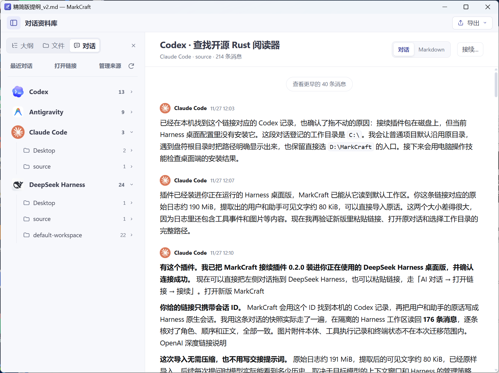
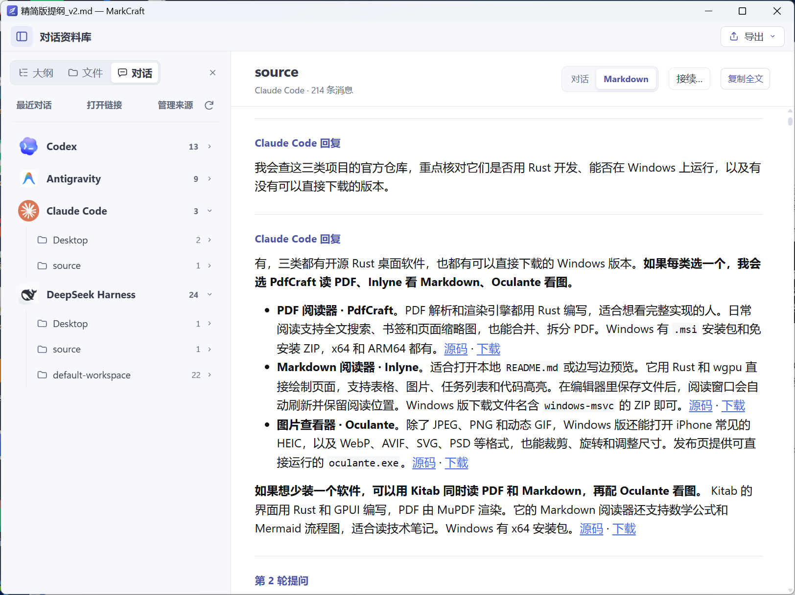
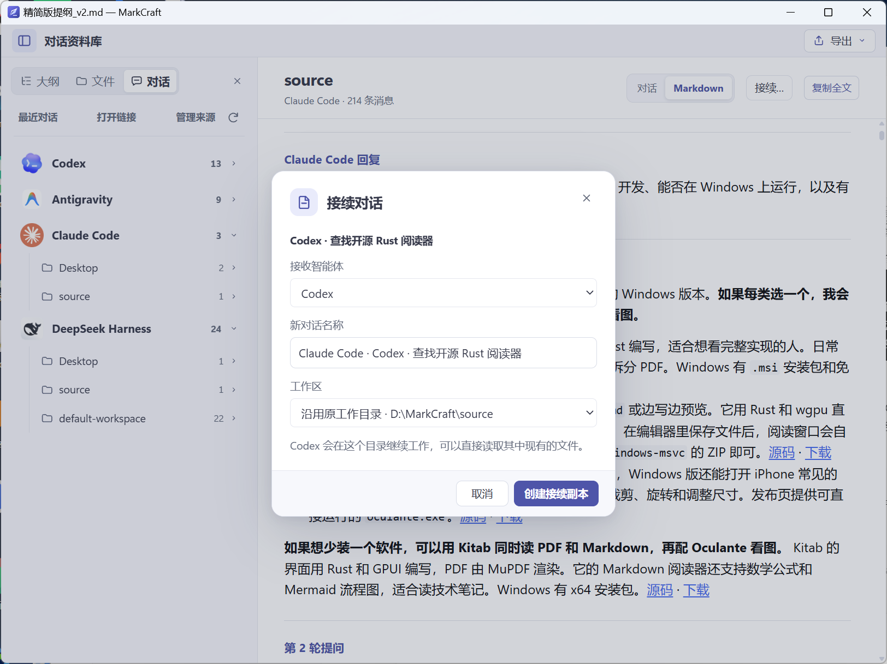
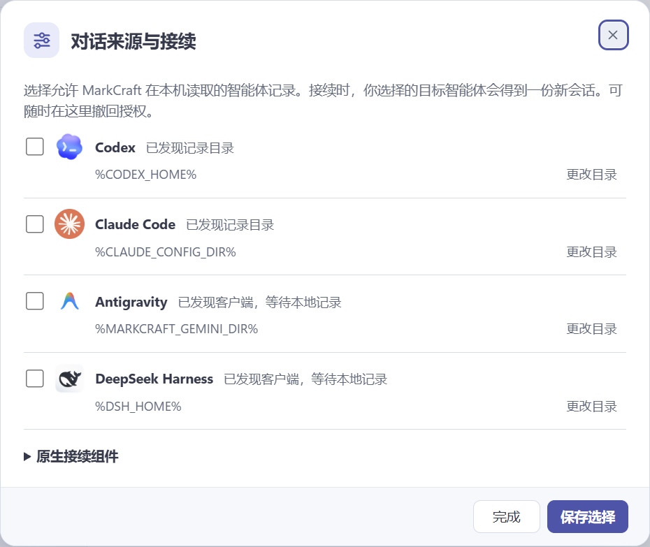

# MarkCraft

**用 Rust 构建的本地优先 Windows Markdown 编辑器与跨智能体对话工作台。**

MarkCraft 把两件高频工作放进同一个本地桌面应用里：**像 Typora 一样打开 `.md` 就在排好版的正文里直接写**，同时把本机 **Codex、Claude Code、Antigravity、DeepSeek Harness** 的历史对话统一管起来——支持原话/Markdown 双视图阅读、全文大纲跳转、多格式导出归档，还能把一场对话连同识别出的项目工作区**直接写成另一款智能体的原生会话继续聊**。免费开源，数据不上传云端。

**[下载 Windows x64 便携版](https://github.com/Hydralune/MarkCraft/releases/latest)** · [示例文稿《散场以后的四班车》](examples/散场以后的四班车.md) · [使用指南](ui/guide.md) · [对话资料库与接续指南](docs/对话资料库.md) · [MIT 许可证](LICENSE)


---

## 核心定位

MarkCraft 瞄准两个很具体的日常痛点：

1. **替代收费桌面 Markdown 编辑器，保留纯粹的本地 `.md` 写作流**
   打开文件就能在排版好的正文里直接改字、填表格、编辑公式，光标离开行内元素后标记自动收起，所有文件以普通文本保存在自己硬盘上。
2. **打通多个本地 Coding Agent 之间的上下文断层**
   写代码时经常需要在多个智能体之间切换——比如在一个工具里讨论完方案、额度用完或卡在某个问题，想切到另一个工具接着改同一份仓库代码。传统的做法是手动总结前情、复制一大段 Prompt 贴过去，不仅繁琐，还容易丢失多轮对话的完整脉络。MarkCraft 把历史对话视为本地工程资产，直接对接目标智能体的原生存储与会话协议，实现**把对话拖过去就能直接说“继续”**。

---

## 核心亮点一：AI 对话资料库与跨智能体原生接续

### 把 Claude Code 里的一段讨论接到 Codex

**找到上次聊到的位置。** 在左侧「对话」按智能体和项目展开，选中会话后，右侧按时间显示问答。图中「查找开源 Rust 阅读器」有 214 条消息，点「查看更早的 40 条消息」可以继续向前翻。



**把长回复当文档读。** 点右上角「Markdown」，同一段讨论会按提问和回复排版。回答里比较 PDF 阅读器、Markdown 阅读器和图片查看器的列表、加粗文字和源码链接都会保留。需要归档时，可点「复制全文」或从「导出」保存为 Markdown 文件。



**换到 Codex 继续。** 点「接续…」，把接收智能体选为 Codex，并核对新对话名称和工作区。图中沿用 `D:\MarkCraft\source`。点「创建接续副本」，再点「在窗口打开」，就能带着前面的问答在同一项目里继续工作。



如果要回到 Claude Code 本身，在对话上右键选「在 Claude Code 窗口打开」即可。MarkCraft 会进入该会话的工作目录，再执行 `claude --resume <id>`。截图中侧栏的 `source` 是目录简称。当前 `main` 分支会在项目行显示完整路径，右键还可以选「复制工作目录」。

### 1. 权限可控的本机来源扫描

从「视图 → 对话资料库」或侧栏「对话」首次进入时，**四个来源默认全部未勾选**，保存前不会扫描任何聊天内容。授权按当前 Windows 用户保存在 `%LOCALAPPDATA%\MarkCraft\chat-sources.json`，随时可在「管理来源」更改目录或撤回权限。

| 来源 | 默认根目录（支持环境变量覆盖） | 作为来源读取的内容 |
| --- | --- | --- |
| **Codex** | `%USERPROFILE%\.codex`（`CODEX_HOME`） | `sessions/`、`archived_sessions/` 下的 `.jsonl` 及 `session_index.jsonl` 标题索引 |
| **Claude Code** | `%USERPROFILE%\.claude`（`CLAUDE_CONFIG_DIR`） | `projects/` 下各项目的会话 `.jsonl` 与 `custom-title` / `ai-title` 标题记录 |
| **Antigravity** | `%USERPROFILE%\.gemini`（`MARKCRAFT_GEMINI_DIR`） | `antigravity/`（桌面端）与 `antigravity-cli/` 下的日志记录及摘要数据库 |
| **DeepSeek Harness** | `%USERPROFILE%\.dsh`（`DSH_HOME`） | Harness 分段压缩日志（含 `zstd` 帧解析）与会话标题更新 |



### 2. 四来源 × 五接收端：各智能体如何实现原生接续

Codex、Claude Code、Antigravity、DeepSeek Harness 的对话都可以**相互跨端接续**，也可以**在同一个智能体内部接续分叉**（自动分配新的分支标识，用来从某段历史开出第二条思路线）。

| 接收端 | MarkCraft 在底层写入了什么 | 使用前提与接续后入口 |
| --- | --- | --- |
| **Codex** | 生成原生 `sessions/YYYY/MM/DD/rollout-*.jsonl`，在 `session_meta` 写入目标端配置的 `model_provider`，按角色写入问答并登记到 `session_index.jsonl` | 安装并登录 Codex。旧版 MarkCraft 创建的副本若提示「模型提供商不可用」，在资料库右键选「在 Codex 窗口打开」，即可补全缺失的提供商并同步索引 |
| **Claude Code** | 按 Claude Code 的 UTF-16 路径哈希规则生成 `projects/<project-key>/<id>.jsonl`，写入带 `uuid` / `parentUuid` 链条的用户与助手记录及 `custom-title` | 安装并登录 Claude Code。接续完成后点「在窗口打开」，或复制含项目路径和 `claude --resume <id>` 的命令 |
| **DeepSeek Harness** | 通过随包提供的插件 `markcraft-handoff`（仅监听 `127.0.0.1` 回环地址并以 64 位随机十六进制令牌校验）直接调用 Harness 的 `workspaceRegistry` 与 `sessionPersistence`，生成原生事件帧并挂载到目标工作区 | 在「管理来源 → 原生接续组件」一键安装插件并运行 Harness 即可。拖入后直接出现在对应工作区侧栏 |
| **Antigravity 桌面端** | 调用官方 `agy acp --stdio` 初始化原生会话壳，向 SQLite `steps` 表写入原话载荷与时间戳，再用 `session/load` **逐条回读核对角色、正文与工作区 URI**，同时关联或创建桌面项目登记（`config/projects/*.json`） | 需 Windows 版 `agy` CLI 1.5.x、支持 `node:sqlite` 的 Node.js 22.13+，且已完成 `agy acp --login`。完成后可在桌面端对应项目侧栏打开（若已打开应用未刷新，重开一次即可） |
| **Antigravity CLI** | 同上走原生 ACP 初始化、SQLite 步进写入与回读校验，登记至 `antigravity-cli` | 前提同上。完成后可直接复制 `agy --conversation <id>` 在目标目录恢复 |

### 3. “无感接续”的关键机制

- **原话提纯与系统噪声剥离**：只抽取用户真实提问与助手可见回复，保留角色、顺序与时间戳；自动剔除各智能体注入的 `<environment_context>`、`<permissions instructions>`、`<user_instructions>`、`<skill>`、`<system-reminder>`、Claude 的 `isMeta`/`isSidechain`/`isCompactSummary` 内部记录、工具执行的超大输出流以及 `<USER_REQUEST>` 包装标签，不把运行环境垃圾带入下一家上下文。
- **自动识别真实项目工作目录**：像 Codex 这类会话有时会从盘符根目录（如 `C:\`）启动，声明目录过于宽泛。MarkCraft 会回溯最近 12 轮内**已成功完成的文件修改（`FileChange` / `patch_apply_end`）和成功命令的工作目录（`CommandExecution` / `exec_command_end`）**，沿路径向上定位 `.git` 或 `Cargo.toml` / `package.json` / `pyproject.toml` / `go.mod` / `CMakeLists.txt`，按轮次权重打分并排除无关文字里提到的路径，自动识别你真正在改的项目文件夹作为目标工作区。
- **三种接续交互方式**：
  1. **拖放即接续**：在左侧栏按住任意对话，直接拖到目标智能体名称（自动识别工作区）、目标项目分支（使用该项目目录）或目标对话上（悬停未展开的智能体 450 ms 会自动展开），沿用默认名称立即创建副本。
  2. **右键复制 / 粘贴接续**：在对话上右键「复制对话」（`Ctrl + C`）并在目标智能体或项目分支上「粘贴为接续会话」（`Ctrl + V`），支持 `F2` 在资料库内重命名。
  3. **「接续…」精细配置**：点击阅读区右上角「接续…」或右键「接续到…」，可自由切换接收智能体（含同智能体分叉多开）、自定义最长 120 字符的新对话名称、核对系统统计的文件变更数/命令次数证据，或手动改选任意本地目录。
- **幂等去重与接续边界**：基于源会话、目标目录、可见消息列表与可选分支/名称计算确定性 SHA-256 ID。把同一段快照重复拖到同一工作区会**直接复用已有副本**而不会刷出大量重复记录。接续范围是**可见原话、角色、顺序、时间戳与项目工作目录**（图片/文件附件以占位标记保留，不迁移附件本体、历史工具调用状态、运行中终端与源端账号凭据；DeepSeek Harness 与 Antigravity 单次原文接续上限为 16 MiB）。

### 4. 对话阅读、统一大纲、深度链接与导出归档

- **原话 / Markdown 双视图与 3 秒增量刷新**：既可用聊天气泡读原话，也能一键切为文档级排版视图；长对话分页按需加载，阅读期间每 3 秒检查一次本机记录并增量同步新消息，往前翻阅时锁定当前位置。
- **双视图共享对话大纲**：切到左侧「大纲」即可按「第 N 轮提问 / 智能体回复 / 回复内多级标题」筛选和折叠跳转，切换原话与 Markdown 视图后位置依然对齐。
- **Codex 深度链接直达**：点「打开链接」粘贴 `codex://threads/<uuid>`（或整段 Markdown 链接），直接从本机已授权资料库定位并打开该会话。
- **对话导出归档**：在对话或 Markdown 视图下，点右上角统一「导出」按钮或按 `Ctrl + S` 可将完整对话另存为 `.md`，也能直接导出为 PDF、Word、HTML、EPUB、ODT、RTF 和 LaTeX。

详细配置与接续排错请参阅 [对话资料库与接续指南](docs/对话资料库.md)。

---

## 核心亮点二：本地优先的即时排版 Markdown 编辑器

- **所见即所得与增量响应**：Rust 后端用 `pulldown-cmark`、`html5ever`、`latex2mathml` 解析结构并转换公式，前端基于 CodeMirror 6 承载输入法与编辑；纯文字段落改动走增量局部更新而不全量重排；光标离开加粗/斜体/链接/行内公式后自动收起标记。点击左下角「源码」或按 `Ctrl + /` 可随时查看带行号和配色的完整源文。
- **原生级表格编辑与拖拽换位**：直接点击单元格中任意字符处落位光标编辑（不额外弹出独立输入框），`Tab` / `Shift + Tab` / `Enter` 顺畅跳转，`Esc` 撤回本次进入单元格后的输入；拖住表头上边缘可整列换位、拖住正文行首格左边缘可整行换位（带透明预览与落点线，`Ctrl + Z` 撤销）；右键单元格调整列对齐、增删行列或复制整表 Markdown。
- **代码、LaTeX 公式、流程图与图片**：
  - 代码块右上角支持搜索语言名称或简称切换语法高亮，支持「选中代码」仅选正文不含围栏；Mermaid 代码块直接渲染为流程图。
  - 行内 `$…$` 与块级 `$$…$$` 公式随输入预览；点击公式自身才展开 LaTeX，编辑公式旁的正文和脚注互不干扰。
  - 剪贴板贴图自动写入文稿旁的 `.assets` 目录；点击图片可改说明、点击路径替换图片、手动改路径或删除图片；「文件 → 收集本文图片」可将分散的本地图与网络图统一归档到 `.assets`。
- **段落手柄、章节折叠与手势多选**：指向段首可通过六点手柄改标题级别、新建、复制或上下拖拽重排；段首箭头可平滑旋转折叠普通段落或整节标题；触屏左右轻扫或鼠标从段首/留白横拖可进入**段落多选**，通过底部工具栏批量转为待办、切换标题、全选、复制、剪切或删除。
- **自动保存与 AI 后台改写保护**：默认停笔约 1 秒自动保存，未命名文稿自动落入「文件 → 草稿箱」。配合内容 SHA-256 校验、磁盘监听器与 Win32 `ReplaceFileW` 原子替换：当后台 AI 或其他编辑器改写当前文稿时，无未保存改动的窗口会自动载入新版并保留滚动位置；两边都有改动则暂停自动保存并弹出「保留两版」冲突窗口，防止覆盖丢稿。
- **长文导航、目录浏览与可定制主题**：大纲支持筛选、折叠和跟随正文滚动高亮；「文件」侧栏支持分支展开、进入目录、后退/前进与返回上一级；`Ctrl + P` 快速模糊打开，`Ctrl + Shift + F` 跨子目录搜索正文并定位到行；默认「澄明浅色」主题支持多级标题自动编号与 `[TOC]` 目录生成，另内置「素笺」「Claudette」「Claudette Dark」主题并支持编辑 CSS 后热重载。


---

## 核心亮点三：统一导出与三栏 Word 排版工作台

窗口右上角与「文件 → 导出」共用同一菜单（阅读对话时自动多出「Markdown 文稿 (.md)…」）：

- **原生 PDF 与网页导出**：按 `Ctrl + Shift + E` 调用 WebView2 原生打印管线导出可选中文字的 PDF（在 `Ctrl + ,` 设置中可调整 A4 / A5 / Letter 纸张、页边距和页码），也可导出独立 HTML。
- **多格式 Pandoc 转换**：配置好 Pandoc 后支持导出 Word（DOCX）、EPUB、ODT、RTF 与 LaTeX 源文件。
- **三栏式 Word 导出工作台**：
  - **左侧模板栏**：内置「通用文稿、学术论文、工作报告、会议纪要、项目方案、人文随笔、技术手册」7 套预设；若将个人或学校排版要求另存为 `%APPDATA%\MarkCraft\word-reference.docx`，此处还会出现「个人模板」。
  - **中间首页预览**：首页默认整页居中显示，支持「页宽 / 整页」切换；本机安装有桌面版 Microsoft Word 时展示真实分页效果（无法调用 Word 时界面明确标注「近似预览」）。
  - **右侧精细样式面板**：按标题、正文、表格分组调整六级标题字号、段前段后间距、字体、颜色、对齐、行距、首行缩进、表头底色与单元格上下内边距。配合内置 `export/word.lua` 过滤器，等宽 Markdown 表格自动按内容分配列宽、跨页自动重复表头，HTML `` 与 `<br>` 也会保留。


---

## 开始使用

1. 前往 [Releases](https://github.com/Hydralune/MarkCraft/releases/latest) 下载 `MarkCraft-v0.4.0-windows-x64.zip`，将**整个文件夹**解压到长期使用的路径。
2. 双击 `MarkCraft.exe` 开始写作，按 `Ctrl + O` 可打开本机的 Markdown 文件。
3. **（可选）关联 `.md` 文件类型与专用文档图标**：在解压目录的 PowerShell 中运行以下命令，再到资源管理器右键 `.md` 文件 →「打开方式」将 MarkCraft 设为默认即可（只对当前 Windows 用户生效；移动目录后重新执行一次即可刷新路径）：

```powershell
.\register-markdown.ps1 -Executable (Resolve-Path .\MarkCraft.exe)
```

> **依赖说明**：程序复用 Windows 自带的 Microsoft Edge WebView2（若启动提示缺少运行时，可前往[微软 WebView2 下载页](https://developer.microsoft.com/en-us/microsoft-edge/webview2/)安装 Evergreen Runtime）。导出 Word、EPUB、ODT、RTF 或 LaTeX 需将 [Pandoc](https://pandoc.org/) 加入 `PATH` 或放在程序同级 `tools/pandoc/pandoc.exe`。

---

## 常用快捷键速查

| 快捷键 | 功能 | 快捷键 | 功能 |
| --- | --- | --- | --- |
| `Ctrl + N` / `Ctrl + O` | 新建 / 打开文稿 | `Ctrl + ,` | 打开设置（写作、导航图片、PDF、对话） |
| `Ctrl + S` / `Ctrl + Shift + S` | 保存（对话视图为导出 `.md`）/ 另存为 | `Ctrl + /` | 切换源码模式 |
| `Ctrl + P` | 快速打开最近文件 | `Ctrl + Shift + F` | 文件夹内全文搜索 |
| `Ctrl + F` / `Ctrl + H` | 当前文稿查找 / 替换 | `Ctrl + Alt + G` | 跳至行（支持 `+5`、`50%`、`12:8`） |
| `Ctrl + Shift + 1` / `3` / `L` | 大纲 / 文件树 / 切换侧栏 | `F8` / `F9` / `F11` | 专注模式 / 打字机模式 / 全屏 |
| `Ctrl + 0` – `6` | 设为正文 / 一至六级标题 | `Ctrl + Shift + E` | 导出为 PDF |

---

## 体积、架构与内存基准

MarkCraft 使用 **Rust（`tao` + `wry`）+ 系统 WebView2** 架构，不捆绑整套 Chromium，因此分发体积小、Rust 主进程开销极低：

- **v0.4.0 分发体积**：Windows x64 便携包约 **3.55 MiB**（含主程序、加载器、Harness 接续插件、离线指南、示例与许可），`MarkCraft.exe` 主程序约 **8.97 MiB**。
- **v0.2.0 单窗口首页静置内存基准**：

| 测试文稿 | 整个进程树专用工作集（中位数） | 5 次实测范围 | Rust 主进程（中位数） |
| --- | ---: | ---: | ---: |
| 普通中文笔记（129 字节，含三项列表） | 91.4 MiB | 90.4–91.7 MiB | 4.5 MiB |
| v0.2.0 基准文稿（5,290 字节，含本地图、48 条明细、代码、公式、流程图） | 99.8 MiB | 97.6–103.9 MiB | 4.5 MiB |

*测量环境：Windows 11 x64（构建 22621）、WebView2 158.0.4370.33。新配置启动单窗口停在首页静置 10 秒，每约 2 秒采集 Windows `WorkingSetPrivate`，合计 MarkCraft 与其 WebView2 子进程（共 7 个进程）。滚动浏览更多图表、加载大图或开启对话资料库时占用会随内容动态变化。*

---

## 从源码构建

在 Windows 上安装支持 **Rust 2024 edition** 的稳定版工具链与对应的 C++ 链接器。仓库内已附带构建好的前端脚本，可直接编译并运行测试：

```powershell
.\build-windows.ps1
cargo test --release --locked
```

使用 `x86_64-pc-windows-gnu` 工具链时，构建脚本会自动复制匹配的 `WebView2Loader.dll` 并嵌入应用与 `.md` 文档图标。

若修改了 `ui/writer.js` 或编辑器前端模块，先重新打包前端再构建 Rust：

```powershell
cd ui
npm ci
npm run build
cd ..
.\build-windows.ps1
```

- **构建完整便携发行包**：运行 `.\package-windows.ps1` 输出到 `dist/`（含 `SHA256SUMS.txt`）。
- **重建 Harness 接续插件**：在仓库根目录运行 `npm pack ./integrations/deepseek-handoff`，将生成的 `.tgz` 放到 `MarkCraft.exe` 同级目录。
- **自定义主题**：主题源文件位于 `themes/`，可在程序「主题 → 打开主题文件夹」直接修改 CSS 并从菜单重载。

---

## 开源许可

MarkCraft 基于 **MIT 许可证** 免费开源。各智能体的品牌图标取自原厂应用或扩展，版权归各自权利人所有。编辑器所集成的 CodeMirror 6、pulldown-cmark、highlight.js、Mermaid、latex2mathml 等第三方组件保留各自的开源许可，Claudette 主题改编自 CookPiu 的作品，便携包 `licenses/` 目录内附完整清单。

[项目许可证 (LICENSE)](LICENSE) · [第三方组件许可](vendor/) · [Claudette 主题许可](themes/Claudette-LICENSE.txt)
