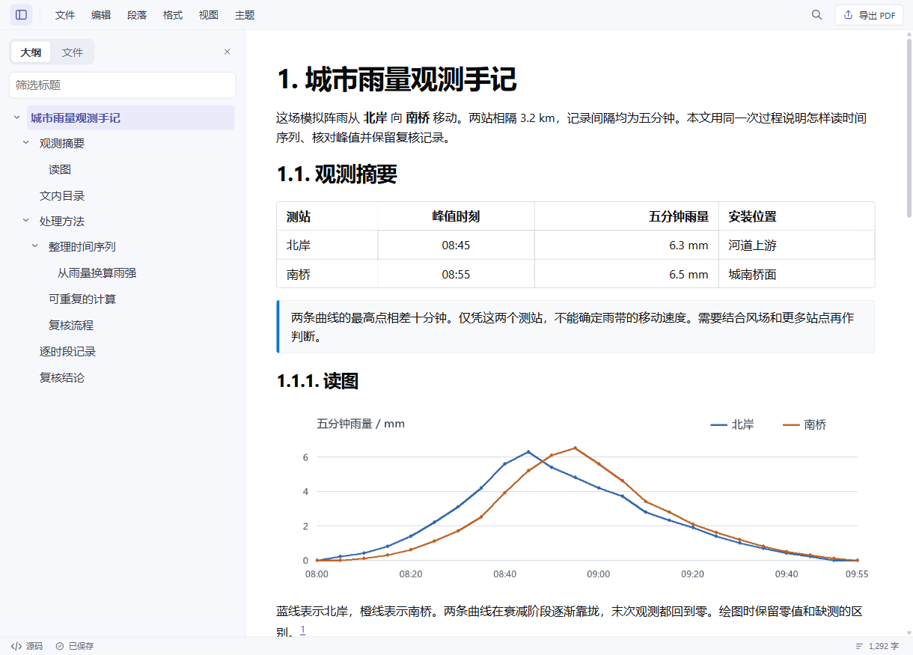
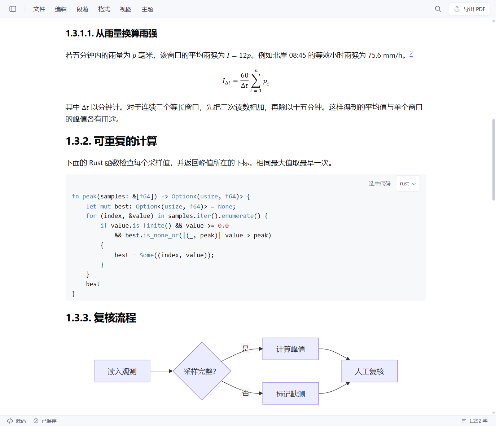
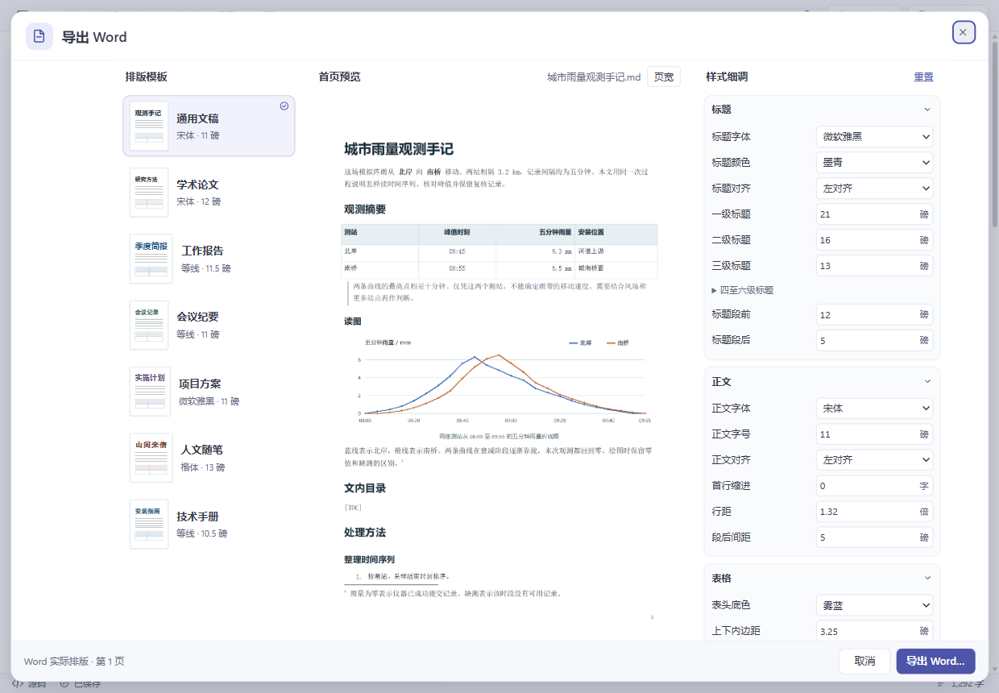

# MarkCraft

**用 Rust 构建的本地优先 Windows Markdown 写作与 AI 对话工作台。**

MarkCraft 将**所见即所得的 Markdown 编辑器**与**跨智能体本地对话资料库**合二为一：日常写作时，打开 `.md` 就能在排好版的正文中直接编辑；与 AI 协作时，又能按项目汇总本机多个 Coding Agent 的对话原话、一键排版导出，甚至将对话与工作区直接接续到另一款智能体继续任务。免费开源，数据始终留在你的电脑本地。

**[下载 Windows x64 便携版](https://github.com/Hydralune/MarkCraft/releases/latest)** · [示例文稿](examples/城市雨量观测手记.md) · [使用指南](ui/guide.md) · [对话资料库与接续指南](docs/对话资料库.md) · [MIT 许可证](LICENSE)



---

## 整体定位

MarkCraft 围绕三条核心原则设计，既替代收费的桌面 Markdown 编辑器，也补全本地 AI 开发工作流中缺失的“对话资产层”：

1. **本地优先、即开即写的纯文本写作**
   采用类似 Typora 的即时排版交互：光标移出时自动隐藏 Markdown 标记，点击单元格或公式即可原位修改，不绑定专有格式，所有内容始终以标准 `.md` 保存于本地磁盘。
2. **面向中文排版与正式交付的导出工作台**
   不仅能直接导出带可选中文字的 PDF，还提供**三栏式 Word 排版工作台**——内置 7 套中文文稿模板与实时首页预览，支持细调六级标题、正文字距与表格样式，打通从笔记到论文、报告和方案的最后一公里。
3. **把 AI 对话当成可检索、可复用、可迁移的一等资产**
   本地 Coding Agent 的历史会话散落在不同目录和格式中。MarkCraft 在显式授权后统一纳管 **Codex、Claude Code、Antigravity 与 DeepSeek Harness** 的本地记录，支持对话/Markdown 双视图阅读、多格式导出归档，以及**跨智能体原生会话接续**。

---

## 核心特色

### 一、即时排版与原生级块编辑

- **所见即所得，无需切窗预览**：标题、引用、嵌套列表、任务清单、脚注与行内格式在正文中直接渲染，仅在光标聚焦到行内元素时才按需展示标记；点击左下角「源码」或按 `Ctrl + /` 可随时切入带语法高亮与行号的完整源码模式。
- **原生体验的表格编辑**：点击文字位置直接输入，`Tab` / `Shift + Tab` / `Enter` 顺畅切换单元格；拖动表头上边缘可移动整列、拖动正文首格左边缘可移动整行，支持半透明预览、落点线与 `Ctrl + Z` 撤销；右键单元格即可调整对齐或增删行列。
- **代码、数学公式与流程图**：代码块支持语言搜索与语法高亮，右上角可一键「选中代码」；行内 `$…$` 与块级 `$$…$$` LaTeX 公式随写随排；Mermaid 代码块直接渲染为流程图。
- **图片管理与一键归档**：支持剪贴板直接贴图并自动保存到文稿旁的 `.assets` 目录；点击图片可修改说明、替换图片文件、调整路径或移除引用；「收集本文图片」可将分散的本地与网络图片集中归档。
- **段落整理与手势多选**：指向段首可通过六点手柄快速转换标题级别、新建、复制或上下拖拽重排，点击箭头平滑折叠段落或整个章节；触屏左右轻扫或鼠标从段首/留白横拖可进入**段落多选**，在底部操作栏批量转为待办、切换标题、复制、剪切或删除。
- **主题与专注视图**：默认「澄明浅色」主题支持多级标题自动编号与 `[TOC]` 目录生成，另内置「素笺」「Claudette」「Claudette Dark」等主题并支持自定义 CSS 热重载；提供专注模式（`F8`）、打字机模式（`F9`）和全屏写作（`F11`）。



### 二、安全保存、外部协同与长文导航

- **默认自动保存与草稿箱**：停笔约一秒自动写回原文件，未命名文稿自动存入「文件 → 草稿箱」，关闭或重启不丢稿。
- **AI 后台改写感知与冲突保护**：当外部编辑器或 AI Agent 在后台修改当前打开的 `.md` 文件时，未编辑的窗口会自动同步新内容并保持滚动位置；若两边均有改动，自动保存会暂停并弹出「保留两版」保护窗口，避免静默覆盖。
- **长文大纲与全目录检索**：左侧大纲支持关键词筛选、章节折叠与跟随滚动高亮；文件夹树支持展开分支、进入目录、后退/前进与返回上一级；`Ctrl + P` 快速模糊打开最近文件，`Ctrl + Shift + F` 搜索整个文件夹正文并跳转定位，`Ctrl + Alt + G` 支持行号、相对偏移、百分比或 `行:列` 跳转。

### 三、统一导出与 Word 排版工作台

窗口右上角与「文件 → 导出」共用统一「导出」菜单，提供一致的导出体验：

- **PDF 与网页导出**：按 `Ctrl + Shift + E` 直接通过原生打印引擎导出可检索文字的 PDF（可在 `Ctrl + ,` 设置中配置 A4 / A5 / Letter 纸张、页边距与页码），也支持导出独立 HTML。
- **多格式文档转换**：配合本地 Pandoc，可导出 Word（DOCX）、EPUB、ODT、RTF 与 LaTeX 源文件。
- **三栏式 Word 导出工作台**：
  - **左侧选模板**：内置「通用文稿、学术论文、工作报告、会议纪要、项目方案、人文随笔、技术手册」7 套样式模板；若将单位或学校格式另存为 `%APPDATA%\MarkCraft\word-reference.docx`，还会自动出现「个人模板」。
  - **中间实时预览**：首页默认整页居中展示，支持「页宽 / 整页」切换；本机装有 Microsoft Word 时直接呈现真实分页效果。
  - **右侧精细微调**：按标题、正文、表格分组调整六级标题字号、段前段后间距、字体颜色、首行缩进、行距、表头底色与单元格内边距。等宽表格自动按内容分配列宽并在跨页时重复表头。



### 四、AI 对话资料库与跨智能体原生接续

> **隐私与权限优先**：首次从「视图 → 对话资料库」或侧栏「对话」进入时，四个来源默认均未勾选。只有在你明确勾选并保存后，MarkCraft 才会只读扫描本机已落盘的记录，且随时可在「管理来源」更改目录或撤回授权。

- **四大智能体统一纳管**：自动识别本机的 **Codex、Claude Code、Antigravity、DeepSeek Harness**（使用原厂图标），按智能体与项目分组展示，资料库打开期间自动增量刷新并锁定当前阅读位置。
- **原话与 Markdown 双视图 + 统一大纲**：既可以按聊天气泡回看原始对话，也能一键切为排版整洁的 Markdown 文稿视图；左侧「大纲」自动提取每一轮提问、回复与正文标题，在双视图间共享定位跳转。
- **对话即文档，随时导出归档**：在对话或 Markdown 视图下，右上角统一「导出」菜单会自动增加「Markdown 文稿 (.md)…」选项（`Ctrl + S`），也可直接将整场对话导出为 PDF、Word、HTML 等格式长期保存。
- **跨智能体原生对话接续**：
  - **拖放即接续**：将左侧任意一条对话拖到另一个智能体或目标项目下，即可将其可见原话直接写入目标智能体的原生会话格式；在同智能体上点击「接续…」也可新开独立分支、修改标题或指定工作区。
  - **自动识别真实工作目录**：当源会话记录的根目录过于宽泛（如仅记录盘符根目录）时，MarkCraft 会结合实际文件编辑与命令执行记录推断真实项目目录，无需手动拼写交接提示词，切到新智能体后直接说「继续」即可顺畅衔接。
  - **深度链接直达**：支持粘贴 `codex://threads/…` 链接，快速定位本机对应的 Codex 会话并预览或接续。

详细配置、插件安装及各接收端要求请参阅 [对话资料库与接续指南](docs/对话资料库.md)。


---

## 开始使用

1. 前往 [Releases](https://github.com/Hydralune/MarkCraft/releases/latest) 下载 `MarkCraft-v0.4.0-windows-x64.zip`，将**整个文件夹**解压到希望长期保存的目录。
2. 双击 `MarkCraft.exe` 即可开始写作，按 `Ctrl + O` 打开已有文件，或打开压缩包内的 `examples/城市雨量观测手记.md` 体验完整排版。
3. **（可选）关联 `.md` 默认打开方式与文档图标**：在解压目录的 PowerShell 中运行下方命令，随后在 Windows 资源管理器右键 `.md` 文件 →「打开方式」设为 MarkCraft 即可：

```powershell
.\register-markdown.ps1 -Executable (Resolve-Path .\MarkCraft.exe)
```

> **运行环境说明**：程序复用 Windows 系统内置的 Microsoft Edge WebView2（若启动时提示缺失，可前往[微软 WebView2 下载页](https://developer.microsoft.com/en-us/microsoft-edge/webview2/)安装 Evergreen Runtime）。需要导出 Word、EPUB、ODT、RTF 或 LaTeX 时，请将 [Pandoc](https://pandoc.org/) 加入系统 `PATH` 或放在 `MarkCraft.exe` 同级的 `tools/pandoc/pandoc.exe`。移动便携目录后重新运行一次注册脚本即可刷新图标与路径。

---

## 常用快捷键速查

| 快捷键 | 功能 | 快捷键 | 功能 |
| --- | --- | --- | --- |
| `Ctrl + N` / `Ctrl + O` | 新建 / 打开文稿 | `Ctrl + ,` | 打开设置（写作、图片、PDF、对话） |
| `Ctrl + S` / `Ctrl + Shift + S` | 保存（对话中为导出 `.md`）/ 另存为 | `Ctrl + /` | 切换源码模式 |
| `Ctrl + P` | 快速打开最近文件 | `Ctrl + Shift + F` | 文件夹内全文搜索 |
| `Ctrl + F` / `Ctrl + H` | 当前文稿查找 / 替换 | `Ctrl + Alt + G` | 跳至指定行或 `行:列` |
| `Ctrl + Shift + 1` / `3` / `L` | 大纲 / 文件树 / 切换侧栏 | `F8` / `F9` / `F11` | 专注模式 / 打字机模式 / 全屏 |
| `Ctrl + 0` – `6` | 设为正文 / 一至六级标题 | `Ctrl + Shift + E` | 导出为 PDF |

---

## 技术架构与性能基准

MarkCraft 采用 **Rust 原生底座 + 系统 WebView2 渲染** 的轻量架构，既免去打包整套独立浏览器内核的体积膨胀，也保证文件 I/O、解析与系统交互的性能与可靠性：

- **Rust 核心层**：基于 `tao` 与 `wry` 管理原生窗口和 WebView2；使用 `pulldown-cmark`、`html5ever`、`latex2mathml` 进行高效解析与公式转换；承担原子写入、外部文件改动监测、Word/Pandoc 导出管线以及本地多智能体日志解析与原生会话写入。
- **轻量前端编辑层**：基于 CodeMirror 6 构建即时排版编辑器与输入法支持，集成 `highlight.js`、`Mermaid` 与 `linkify-it`。
- **分发体积**：`v0.4.0` Windows x64 便携压缩包约 **3.55 MiB**（含主程序、加载器、Harness 接续插件、离线文档与示例），`MarkCraft.exe` 主程序约 **8.97 MiB**。

### 单窗口内存基准（v0.2.0 实测参考）

| 测试文稿 | 整棵进程树专用工作集（中位数） | 5 次实测范围 | Rust 主进程（中位数） |
| --- | ---: | ---: | ---: |
| 普通中文笔记（129 字节，含三项列表） | 91.4 MiB | 90.4–91.7 MiB | 4.5 MiB |
| 《城市雨量观测手记》（5,290 字节，含本地图、48 行表格、代码、公式、流程图） | 99.8 MiB | 97.6–103.9 MiB | 4.5 MiB |

*测量环境：Windows 11 x64（构建 22621）、WebView2 158.0.4370.33。使用全新配置打开单窗口停留在首页静置 10 秒，每隔约 2 秒采集 `WorkingSetPrivate`，合计 MarkCraft 与其拉起的 WebView2 子进程（每次共 7 个进程）。浏览长文、加载多张大图或开启对话资料库时占用会随内容动态变化。*

---

## 从源码构建

### 1. 编译与运行测试

在 Windows 上安装支持 **Rust 2024 edition** 的稳定版工具链与对应的 C++ 链接器。仓库内已包含预构建的前端脚本，可直接编译并测试：

```powershell
.\build-windows.ps1
cargo test --release --locked
```

使用 `x86_64-pc-windows-gnu` 工具链时，脚本会自动复制匹配的 `WebView2Loader.dll` 并嵌入应用与文档图标。

### 2. 修改前端界面或重新打包

若修改了 `ui/writer.js` 或其依赖的编辑模块，需先重新打包前端资源，再执行 Rust 构建：

```powershell
cd ui
npm ci
npm run build
cd ..
.\build-windows.ps1
```

- **打包发行版**：运行 `.\package-windows.ps1` 可在 `dist/` 生成完整便携 ZIP 包及 `SHA256SUMS.txt`。
- **重建 Harness 接续插件**：从根目录执行 `npm pack ./integrations/deepseek-handoff` 即可生成对应 `.tgz` 放到 `MarkCraft.exe` 同级目录。
- **自定义主题**：主题源文件位于 `themes/`，也可直接在软件「主题 → 打开主题文件夹」中修改 CSS 并热重载。

---

## 开源许可

MarkCraft 本身基于 **MIT 许可证** 免费开源，允许自由使用、修改与分发。各智能体的品牌图标均取自原厂应用或扩展，版权归各自权利人所有。编辑器内集成的 CodeMirror 6、pulldown-cmark、highlight.js、Mermaid、latex2mathml 等第三方组件保留各自原始许可，Claudette 主题改编自 CookPiu 的作品。便携包的 `licenses/` 目录内附有完整第三方许可清单。

[项目许可证 (LICENSE)](LICENSE) · [第三方组件许可](vendor/) · [Claudette 主题许可](themes/Claudette-LICENSE.txt)
