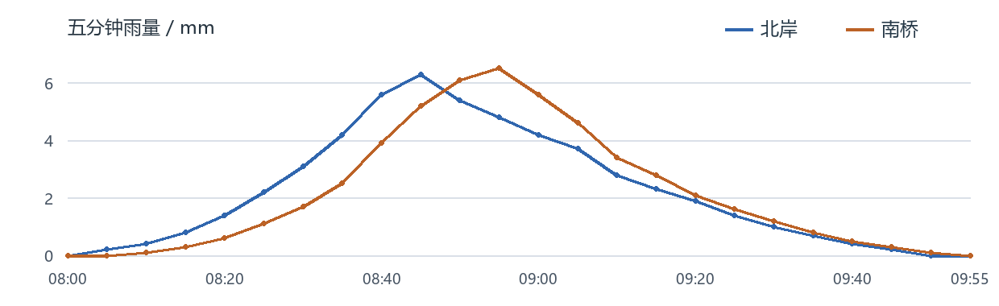
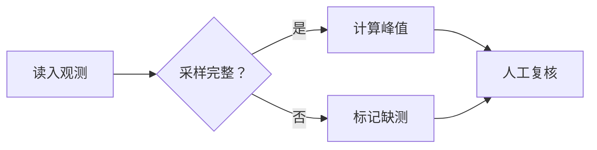

# 城市雨量观测手记

这场模拟阵雨从 **北岸** 向 **南桥** 移动。两站相隔 3.2 km，记录间隔均为五分钟。本文用同一次过程说明怎样读时间序列、核对峰值并保留复核记录。

## 观测摘要

| 测站 | 峰值时刻 | 五分钟雨量 | 安装位置 |
| :--- | :---: | ---: | :--- |
| 北岸 | 08:45 | 6.3 mm | 河道上游 |
| 南桥 | 08:55 | 6.5 mm | 城南桥面 |

> 两条曲线的最高点相差十分钟。仅凭这两个测站，不能确定雨带的移动速度。需要结合风场和更多站点再作判断。

### 读图



蓝线表示北岸，橙线表示南桥。两条曲线在衰减阶段逐渐靠拢，末次观测都回到零。绘图时保留零值和缺测的区别。[^missing]

## 文内目录

[TOC]

## 处理方法

### 整理时间序列

1. 按测站、采样结束时刻排序。
   - 遇到重复时间戳时，先核对采集日志。
   - 对无法复核的值保留缺测标记。
2. 计算窗口统计量。
   - [x] 校对两个站点的单位和采样间隔。
   - [x] 对照曲线和原始记录中的最高点。
   - [x] 加入第三个站点校验时间差。

#### 从雨量换算雨强

若五分钟内的雨量为 $p$ 毫米，该窗口的平均雨强为 $I=12p$。例如北岸 08:45 的等效小时雨强为 75.6 mm/h。[^intensity]

$$
I_{\Delta t}=\frac{60}{\Delta t}\sum_{i=1}^{n}p_i
$$

其中 $\Delta t$ 以分钟计。对于连续三个等长窗口，先把三次读数相加，再除以十五分钟。这样得到的平均值与单个窗口的峰值各有用途。

### 可重复的计算

下面的 Rust 函数检查每个采样值，并返回峰值所在的下标。相同最大值取最早一次。

```rust
fn peak(samples: &[f64]) -> Option<(usize, f64)> {
    let mut best: Option<(usize, f64)> = None;
    for (index, &value) in samples.iter().enumerate() {
        if value.is_finite() && value >= 0.0
            && best.is_none_or(|(_, peak)| value > peak)
        {
            best = Some((index, value));
        }
    }
    best
}
```

### 复核流程



## 逐时段记录

下表保留两个测站全部 **48 条**记录。同一时刻的两个读数相邻排列，方便逐行检查。编号 N 和 S 分别指北岸和南桥。

| 编号 | 结束时刻 | 测站 | 五分钟雨量（mm） | 质量标记 |
| :--- | :---: | :--- | ---: | :--- |
| N01 | 08:00 | 北岸 | 0.0 | 无降水 |
| S01 | 08:00 | 南桥 | 0.0 | 无降水 |
| N02 | 08:05 | 北岸 | 0.2 | 有效记录 |
| S02 | 08:05 | 南桥 | 0.0 | 无降水 |
| N03 | 08:10 | 北岸 | 0.4 | 有效记录 |
| S03 | 08:10 | 南桥 | 0.1 | 有效记录 |
| N04 | 08:15 | 北岸 | 0.8 | 有效记录 |
| S04 | 08:15 | 南桥 | 0.3 | 有效记录 |
| N05 | 08:20 | 北岸 | 1.4 | 有效记录 |
| S05 | 08:20 | 南桥 | 0.6 | 有效记录 |
| N06 | 08:25 | 北岸 | 2.2 | 有效记录 |
| S06 | 08:25 | 南桥 | 1.1 | 有效记录 |
| N07 | 08:30 | 北岸 | 3.1 | 有效记录 |
| S07 | 08:30 | 南桥 | 1.7 | 有效记录 |
| N08 | 08:35 | 北岸 | 4.2 | 有效记录 |
| S08 | 08:35 | 南桥 | 2.5 | 有效记录 |
| N09 | 08:40 | 北岸 | 5.6 | 峰值区间 |
| S09 | 08:40 | 南桥 | 3.9 | 有效记录 |
| N10 | 08:45 | 北岸 | 6.3 | 峰值区间 |
| S10 | 08:45 | 南桥 | 5.2 | 峰值区间 |
| N11 | 08:50 | 北岸 | 5.4 | 峰值区间 |
| S11 | 08:50 | 南桥 | 6.1 | 峰值区间 |
| N12 | 08:55 | 北岸 | 4.8 | 有效记录 |
| S12 | 08:55 | 南桥 | 6.5 | 峰值区间 |
| N13 | 09:00 | 北岸 | 4.2 | 有效记录 |
| S13 | 09:00 | 南桥 | 5.6 | 峰值区间 |
| N14 | 09:05 | 北岸 | 3.7 | 有效记录 |
| S14 | 09:05 | 南桥 | 4.6 | 有效记录 |
| N15 | 09:10 | 北岸 | 2.8 | 有效记录 |
| S15 | 09:10 | 南桥 | 3.4 | 有效记录 |
| N16 | 09:15 | 北岸 | 2.3 | 有效记录 |
| S16 | 09:15 | 南桥 | 2.8 | 有效记录 |
| N17 | 09:20 | 北岸 | 1.9 | 有效记录 |
| S17 | 09:20 | 南桥 | 2.1 | 有效记录 |
| N18 | 09:25 | 北岸 | 1.4 | 有效记录 |
| S18 | 09:25 | 南桥 | 1.6 | 有效记录 |
| N19 | 09:30 | 北岸 | 1.0 | 有效记录 |
| S19 | 09:30 | 南桥 | 1.2 | 有效记录 |
| N20 | 09:35 | 北岸 | 0.7 | 有效记录 |
| S20 | 09:35 | 南桥 | 0.8 | 有效记录 |
| N21 | 09:40 | 北岸 | 0.4 | 有效记录 |
| S21 | 09:40 | 南桥 | 0.5 | 有效记录 |
| N22 | 09:45 | 北岸 | 0.2 | 有效记录 |
| S22 | 09:45 | 南桥 | 0.3 | 有效记录 |
| N23 | 09:50 | 北岸 | 0.0 | 无降水 |
| S23 | 09:50 | 南桥 | 0.1 | 有效记录 |
| N24 | 09:55 | 北岸 | 0.0 | 无降水 |
| S24 | 09:55 | 南桥 | 0.0 | 无降水 |

## 复核结论

北岸先达到峰值，南桥峰值稍高。两个测站各有 24 个有效窗口。这份示例使用合成观测值，所有计算都可以由表中数据重现。返回[观测摘要](#观测摘要)可核对最初的汇总。

[^missing]: 雨量为零表示仪器已成功提交记录。缺测表示该时段没有可用记录。

[^intensity]: 等效小时雨强是单位换算，实际一小时累计降水还取决于完整时段的其余采样。
