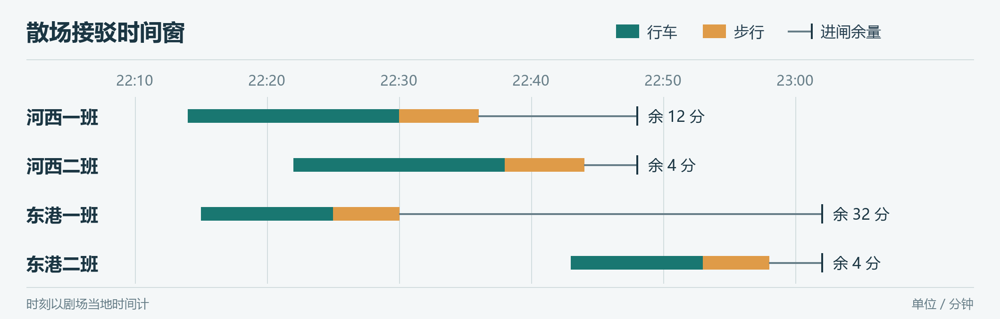

# 散场以后的四班车

剧场的灯在 22:10 亮起。东门外有三辆车，158 位观众登记了接驳。河西站离得远，末班地铁又先关闸。调度员把甲、乙两辆车都拨给河西，让丙车折返一次，接完去东港的人。

## 先看闸机，再排发车

河西站从落客点走到闸机要 6 分钟，东港站要 5 分钟。下图把这段步行也画进了时刻表。从橙色步行段的终点到关闸竖线，细线越短，越经不起耽搁。

### 东门发车单

| 去向 | 车辆 | 发车 | 到站 | 抵达闸机 | 关闸 | 登记人数 |
| :--- | :---: | :---: | :---: | :---: | :---: | ---: |
| 河西一班 | 甲 | 22:14 | 22:30 | 22:36 | 22:48 | 42 |
| 河西二班 | 乙 | 22:22 | 22:38 | 22:44 | 22:48 | 44 |
| 东港一班 | 丙 | 22:15 | 22:25 | 22:30 | 23:02 | 40 |
| 东港二班 | 丙 | 22:43 | 22:53 | 22:58 | 23:02 | 32 |

东港一班最宽裕，离关闸还有 32 分钟。两条线的第二班都只剩 **4 分钟**。再多等一分钟，同车几十人的换乘时间也会一起少一分钟。

每辆车有 45 个乘客座位。河西两班合计只空 4 个座位，东港两班合计空 18 个。现场补登要按去向分别计数，东港的空座解决不了河西的排队。

### 丙车的折返账

东港一班到站后留 2 分钟下客，22:27 空车返回，22:37 才能再次停靠剧场东门。从靠站到第二次发车只有 6 分钟。值班员要在它回来以前数清第二班的人数，确认队尾和上车点都在东门。

## 四分钟是怎么算出来的

设 $C$ 为停止进闸的时刻，$D$ 为接驳车发车时刻，$R$ 和 $W$ 分别为行车、步行分钟数。两项时刻从同一个起点计时，得到的余量 $S$ 也以分钟计。

$$
S = C - (D + R + W)
$$

以 22:00 为零点，东港二班的计算是 $62 - (43 + 10 + 5) = 4$。如果丙车晚回 5 分钟，装客仍用 6 分钟，预计到闸时就已经晚了 1 分钟。

~~~python
def margin(depart, ride, walk, close):
    return close - (depart + ride + walk)

assert margin(depart=43, ride=10, walk=5, close=62) == 4
assert margin(depart=48, ride=10, walk=5, close=62) == -1
~~~

### 把余量用在哪里

河西二班若遇到 3 分钟的路口排队，余量会从 4 分钟降到 1 分钟。如果有乘客还需要额外 3 分钟步行，就会错过关闸。东门问询台在分车时应先问一句「从落客点走到闸机，六分钟够吗？」，并优先给需要更多步行时间的人安排河西一班。[^walk]

## 丙车没有按时回来

东港二班若在 22:47 发车，乘客正好在关闸时刻赶到闸机。若另备一辆空车停在东门，装客同样要 6 分钟。拖到 22:41 才作决定，就连一分钟的余量都没有了。

~~~mermaid
flowchart TD
    A["22:38 核对丙车位置"] --> B{"丙车已靠站？"}
    B -->|是| C["立即装客，记录实际发车时刻"]
    B -->|否| D{"备用车在东门？"}
    D -->|是| E["改用备用车，预计 22:44 发车"]
    D -->|否| F["通知站方与候车人，确认后续出行安排"]
~~~

22:38 是现场决策点。此时启用已经在门口的备用车，预计 22:59 到闸，还有 3 分钟。备用车若要从车库开来，这套时间表就不成立。联系站方时应同时报出**尚在等车的人数和预计到闸时刻**，方便对方判断能提供什么帮助。

## 值班员交接页

- [x] 按去向核过名单。河西 86 人，东港 72 人。
- [x] 给东港两班分开发车牌，第二班在东门原地候车。
- [ ] 散场前确认备用车车号、司机和停靠位置。空栏按无备用车处理。
- [ ] 22:38 记下丙车位置、东港候车人数和调度决定。
- [ ] 次日补录最后一位乘客的到闸时刻，核对走路用时和路口延误。

> 本文为虚构剧场的一次桌面推演。人数、行程与关闸时刻均为设定值。

[^walk]: 步行用时从车门开启算到进站闸机。下雨、绕行无障碍通道或携带行李时，值班员应按乘客实际需要留出时间。
